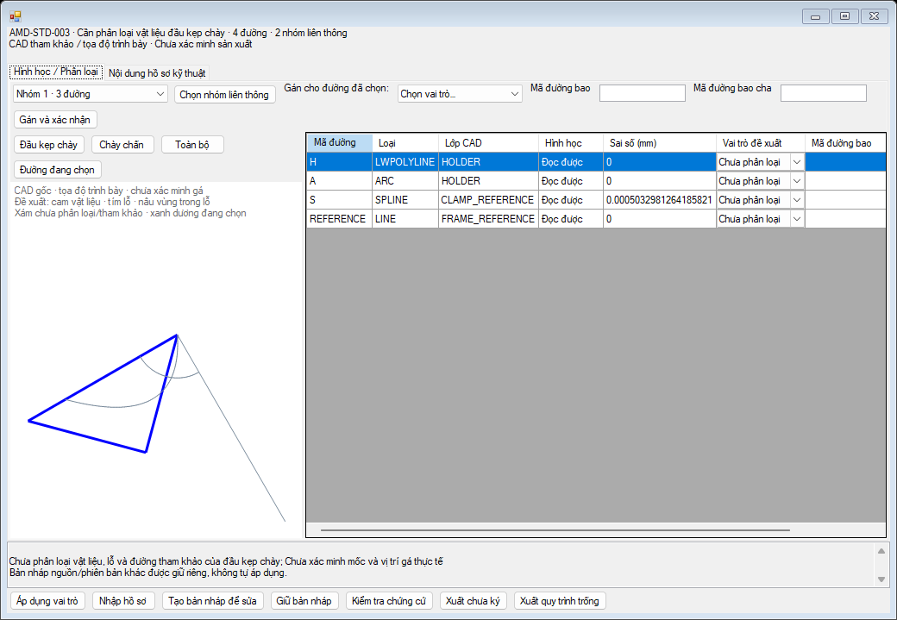

# Check Chấn — consolidated fix and acceptance

**Latest native acceptance after the harness log fix (baseline `68049e1`):** [current five-case report](POST_LOGFIX_NATIVE_ACCEPTANCE_20261020.md). XL-02 **PASS including idle/running close, Disconnect and ExitApp**. XL-17 functional checks PASS, recovered from the exact failed-session dump; the shared session then crashed during the XL-19 independent native audit with `0xc0000374` (PID 24660). XL-19 FAIL native; XL-32 and small Assembly NOT RUN. Two startup-registry comparisons show 57 keys/88 values unchanged. No product code changed; heap origin remains unidentified. **BLOCKED; no further native retries.** The reports below retain historical results at their own checkpoints.

**Focused close-crash investigation:** [latest technical report](CLOSE_CRASH_INVESTIGATION_20261020.md). Root cause of PID 73032 heap corruption remains unidentified. Exactly one new controlled probe was interrupted by a diagnosed harness log-sharing race; shutdown cleanup exited 0, but running-close and four subsequent cases remain NOT RUN. Only opt-in tracing and diagnostic/test repairs were added; no production lifetime repair is claimed. **BLOCKED.**

**Latest bounded delivery (2026-10-20):** see [the five-case acceptance report](BOUNDED_ACCEPTANCE_20261020.md). It supersedes the current readiness verdict: final Release has a native `0xc0000374` failure during close-while-running; XL-02 is FAIL overall and four other representative cases are NOT RUN. Earlier isolation PASS results below remain historical evidence, not a stability guarantee. Production and native acceptance remain **BLOCKED**.

This report supersedes the acceptance verdict in [the earlier validation](VALIDATION_IMPLEMENTATION.md). Compiled source checkpoint: `7c837b96b7231ca5d689b3602a48622a52e7908b`; later documentation/evidence commits do not change its compiled code. It continues PR #37 from `0bb92687b4235cb09b69af95c3fb0609a3c80f20`; no other PR or main branch is merged. Public evidence contains counts and controlled fixture measurements, not company CAD, coordinates, source handles, review keys or raw dumps.

## Decision

**Production acceptance remains BLOCKED.** The authoring workflow can be used to prepare review input within the tested native isolation condition. It cannot certify the company Holders, setups, process states or a common production tool. Company numeric queries remain **0**, deliberately.

Native acceptance is conditional: the new default-scope Assembly RPC remains unresolved; isolated test success must not be treated as general stability. The native coexistence defect has a reproducible session isolation: unloading the installed **XToolPro** in an explicitly owned test process allowed actual in-process target lifecycle/command and clean shutdown. This is an opt-in test condition, not an automatic production workaround or a change to daily add-in settings. A separate RPC failure series overlapped another COM automation client; its failures are retained separately.

## A1 — lossless Holder authoring

`HolderReviewEditorData` binds recovery to ToolId, master/manifest/binding hashes and the native sheet binding, including configuration, snapshot/update stamp, FeatureId and frame. `LoadProposal` now restores every declared entity role, contour ID and parent to the actual grid. Duplicate/foreign keys and invalid parent metadata are rejected before replacing the current input.

- Import → table edit → export → reimport retains Solid/Hole/Island/Reference/Annotation and nesting. Direct document edits refresh the grid before export. Conflicting document/table edits require an explicit choice and archive both buffers first.
- Switching Tool, Part or bend saves a private recovery file before replacing either buffer. Incomplete document text is preserved and can be restored. A failed recovery write refuses the switch/normal close. Force-terminating the process is outside this guarantee.
- Source/revision mismatch is rejected. A different native binding is read-only and needs an explicit unsigned fork; only the source-bound material classification is copied to the new native context, not old seating/axial approvals.
- Inputs with attestation fields remain read-only. An explicitly confirmed fork preserves the original and removes attestations/physical confirmation from the new editable copy. Verifier policy is unchanged; a field containing coordinates or a proof object is not an approval.
- Connected groups select whole original entities, including unsupported entities still listed in the grid. They never split, close, repair, transform, or classify a curve. Bulk assignment starts with a blank role and requires confirmation. Unassigned geometry has a neutral preview color.
- A real repeated-close/dispose GUI test exposed `CancellationTokenSource.Cancel()` being called again after disposal. Cleanup is now guarded once in `Dispose`; the host-close/repeated-dispose regression passes.

Recovery and round-trip target the currently supported proposal schema; they are not a promise to preserve arbitrary unknown future JSON fields. Recovery files are private local authoring data, not library installation or runtime evidence. They are kept under the user's local `ADDIN/BendTools/PrivateReviewDrafts` directory, or an explicitly supplied private test directory.

## A2 — display semantics

Untranslated reasons now use neutral wording and retain their original code in technical detail. CLEAR/COLLISION/UNKNOWN still come from the existing enums and converters. A missing clearance displays “Chưa tính được”, distinctly from measured `0 mm`; callouts no longer interpolate an empty nullable number after `≥`.

The default Part explanation summarizes the common missing inputs for all 18 unknown tools. Technical mode recovers raw reasons and witness information. CAD presentation coordinates, references and unsigned proposals are explained in Vietnamese. The technical document editor is an explicitly selected tab.

No Check Min math, numeric solver, planning/tool-change preference, Designer, native selection/update command flow or other commands were rewritten. Existing display-only binding/tooltip expressions changed; resource cleanup in the evidence control was fixed as described above.

## B — actual 18-Holder readiness

Actual source inventory and fixed pair checks were rerun: **18/18 pairs**, **5,572 Holder source entities**, **160 supported SPLINE entities**, **17 valid closed Punch regions**, one original open KIK Punch. The new group selection additionally checks that every actual source entity remains selectable. Company review inventory: **37 assertions**; fixed CAD pairing: **16,977 assertions**. The [complete 18-tool readiness table](ConsolidatedResults/comparison/holder-status.md) preserves every tool, including open KIK.

| Stage | Actual company result |
| --- | --- |
| Original CAD display/inventory and fixed pair identity | 18/18 available |
| Source-bound unsigned proposal and private inventory | 18/18 prepared |
| Connected selection, explicit roles, preview and complete-key check | Implemented; controlled regression passes |
| Material roles externally reviewed | **0/18** |
| Physical Punch–Holder seating/ClampVerified | **0/18** |
| Verified usable axial span and real process motion | Missing |
| Company numeric collision / company Phase 4B solution | **BLOCKED / UNKNOWN**, zero numeric queries |

Sixteen Holders each have 347 entities, 32 connected components, 4 simple closed and 28 open/branched components. Two ATC Holders each have 10 entities, 8 components, 2 closed and 6 open/branched. These observations do not say which boundaries are real material. All entities still need a qualified reviewer; no engineering classification was invented to complete the table.

## C — original 33 saved native fixtures

**Checkpoint distinction:** the most recent complete 33-case replay executed `60aa31d`, immediately before the legacy polling guard. The final `7c837b9` binary was **not** replayed across all 33 after the later owned startup failures. The guard only changes the legacy launcher scan entries; numeric/Min/native geometry code is unchanged, but this source comparison is not substituted for execution.

| Configuration / executed checkpoint | Cases | Native bends | Static / process candidates | Min OK / NG | Numeric queries | Shutdown | Mean cold / warm |
| --- | --- | --- | --- | --- | --- | --- | --- |
| debug / 60aa31d | 33/33 PASS | 72 | 1296 / 1296 | 69 / 3 | 0 | PASS, all 3 partitions | 3.898 / 1.187 s |
| release / 60aa31d | 33/33 PASS | 72 | 1296 / 1296 | 69 / 3 | 0 | PASS, all 3 partitions | 3.383 / 0.986 s |

Both native geometry and the full cold output exactly equal PR #35; all protected source bytes are unchanged. Warm runs reuse 33/33 captures with zero new native capture and zero numeric queries. Static Punch, Holder, process and Phase 4B retain UNKNOWN/NeedsEvidence. See the complete [Debug table](ConsolidatedResults/native-debug/native-cases.md), [Release table](ConsolidatedResults/native-release/native-cases.md) and their CSV companions; each table names its exact executed DLL SHA.

Final-binary 33-case replay: **NOT RUN**. This is an outstanding native acceptance gate.

The same 33 saved Parts and 72 native bends from PR #35 are reused read-only. No replacement fixture series is generated. Each bend retains 18 exact CAD pairs, separate Punch and Holder status, Min metadata and the original native identity. Reference axial lengths 4200/6000 mm remain references, not certified tool capacity.

XL-17 is the original AL3 U section, axial 6000, W=50 and L=100 mm, with native FeatureIds 53/59. Its Min comparisons remain C=50 ≥ 18 and A=100 ≥ 14.9 mm. XL-19/20/21 retain the original ST3.2 Min NG at A=15 < 15.2 mm. Software execution PASS must not be read as manufacturing PASS.

## D — native root cause and controlled evidence

The current dump again shows `0xc0000374`, `HEAP_CORRUPTION_ACTIONABLE_BlockNotBusy_DOUBLE_FREE`, with `ucrtbase!free_base`, `sldappu!swTaskpaneView_c::getAuDispatch`, `clr!RCW::ReleaseAllInterfaces` and COM shutdown. Two `CommandManagerClass` wrappers remain in the private dump. This repository does not obtain an `ICommandManager`. The stack identifies the failing release path; it does not by itself prove ownership or fault in a vendor's source.

A/B [summary with exact binary hashes](ConsolidatedResults/coexistence-ab.json) used the exact owned PID, unchanged fixture, recorded loaded DLL path/SHA/MVID, and the same test action. The temporary bridge executes the **real target** `SwAddin.ConnectToSW`, real existing Check Chấn button handler, actual live backend, and target `DisconnectFromSW` on the host control's STA. Per-bend 18-unique-tool counts, native FeatureIds, detached roots, borrowed-host usability and fixture bytes are checked. No SOLIDWORKS COM is moved to a worker.

| Condition | Target | In-process command | Shutdown |
| --- | --- | --- | --- |
| Other installed add-ins left loaded | Baseline 0bb | PASS | NOT_CONFIRMED / overall FAIL |
| Other installed add-ins left loaded | Updated Release | PASS | NOT_CONFIRMED; heap dump captured |
| All registered add-ins unloaded in owned session | Updated Release | PASS | PASS |
| **Only XToolPro** unloaded in owned session | Baseline 0bb | PASS | PASS |
| **Only XToolPro** unloaded in owned session | Updated Release | PASS | PASS |
| **Only XToolPro** unloaded in owned session | Updated Debug | PASS | PASS |

The final Debug DLL completed actual in-process lifecycle/command and clean shutdown: source `7c837b9`, two native FeatureIds 53/59, 36 candidates, 18 unique tools per bend. Connect/Disconnect returned true, target roots were detached and the borrowed host remained usable. Fixture bytes/startup flags were unchanged. The final Release DLL built successfully, but three fresh owned attempts stopped at startup before target load (two SW 32.5, one SW 33.5); **actual final Release DLL load/lifecycle is NOT RUN** and the attempts are **FAIL / shutdown NOT_CONFIRMED**. The preceding `60aa31d` Debug/Release binaries both passed the real in-process gate. [Current versus retained lifecycle facts](ConsolidatedResults/native-lifecycle.json), [binary identity](ConsolidatedResults/binary-identity.json) and [failure ledger](ConsolidatedResults/failed-attempts.json) keep these separate.

This demonstrates a reproducible coexistence condition and a safe **owned-session test** isolation, without randomly releasing COM objects, changing solver budgets or extending shutdown deadlines. It does not justify automatically unloading somebody else's add-in in normal use. The binary of the external add-in has not been modified or audited for a repair.

**Activation scope:** the bridge is a unique temporary per-user COM control. The actual target lifecycle methods are invoked in-process with a test cookie through that control; the installed production CLSID/startup flags are not replaced. Automatic production `LoadAddIn`/registered callback deployment is **NOT RUN**. A successful LoadAddIn return or mapped module alone was explicitly rejected as proof. VSTA was also rejected because it ran in an external process. Those preliminary probes are not acceptance PASS results.

One additional Release matrix series returned RPC `0x800706BE` at `IFeature.GetID`, followed by server-unavailable errors, while another COM measurement executable was running. Its source calls `ExitApp`; Windows recorded its failure in the same period. This supports a shared-environment interference risk, not a proved same-PID causal trace. The user paused that automation before the exclusive replay. The interrupted series remains **25 functional PASS / 8 FAIL**, not silently combined with later successes.

### Native polling ownership

A private harness stack captured the legacy Min timer inside `GetActiveSketch2` while the Batch child was open. That run eventually passed, so this is not proof of a deadlock. The launcher already intended to stop the old timer; a queued `Shown` can restart it later. `RequestScan` and `Tick` now enforce the same ownership rule at their entry points, stop the legacy timer while the Batch window is alive, and leave the existing callbacks and Min algorithms intact. The native regression deliberately restarts the timer, calls both entries, then checks that closing Batch restores the Min timer and permits a new Min scan. All three assertions passed in the final Debug 120/25 run (4,152 assertions total). No arbitrary COM release or changed timeout is involved.

### Additional default-scope Assembly RPC

A new final-source Debug Assembly run without the external harness command scope failed at assertion 56: `0x800706BE` in `IComponent2.GetParent`, via `ComponentIdentity`/`AssemblyOccurrenceState`, before numeric work or the new late-timer test. Its owned server exited `-1`. The previous native replay on source checkpoint `60aa31d` passed 4,149 assertions in both configurations. This new failure is retained independently and is not repaired by labeling an occurrence valid. A controlled replay uses the existing `CommandInProgress` harness option for the out-of-process read sequence; this setting reduces native updates according to [the official SOLIDWORKS API contract](https://help.solidworks.com/2024/english/api/sldworksapi/SolidWorks.Interop.sldworks~SolidWorks.Interop.sldworks.ISldWorks~CommandInProgress.html). That replay passed all 4,152 assertions and clean shutdown. It establishes an additional test condition, not a vendor-root-cause repair or production deployment approval.

Windows access-violation events at other PIDs were also present around earlier test times. They are not attributed to these owned sessions merely from timestamps. The newly failed owned PID did not have a matching event in the captured event-log window; no unrelated dump is presented as its crash stack.

## E — unified validation

| Test | Executed scope | Result |
| --- | --- | --- |
| Product, managed, GUI and native harness builds x64 | Debug / Release, compiled product 7c837b9 | PASS: all 8 builds |
| Managed geometry / motion / Assembly / importer regression | Debug / Release final source | 321 / 321 groups; 9,186 assertions each; 0 failures |
| Planning and Check Min rule regression | Debug / Release | 24 / 24 groups; 609 assertions each; 0 failures |
| GUI authoring / status / stale / cancel / layout | Debug / Release final source | 23 groups each; 232 / 231 assertions; 0 failures |
| Wrapper startup versus actual binary mismatch result | Actual final wrapper gate | PASS: 3 cases, no SOLIDWORKS |
| Actual CAD fixed pairs / Holder inventory | Actual company source, unchanged | PASS: 18/18; 16,977 / 37 assertions; 0 roles approved |
| Native 0/3/6 Part, warm cache, rebuild / Refresh, Min projection | 7c837b9 Debug | PASS: 219 assertions; clean shutdown PASS |
| Native 120/25 all / selected / mixed / cancel / stale / exact independent backend output | 7c837b9 Debug, external command scope + XToolPro session isolation | PASS: 4,152 assertions; native timer guard and Min resume PASS; shutdown PASS |
| Native Assembly default-scope replay | 7c837b9 Debug | FAIL at 56 assertions: GetParent RPC; server exit -1; unresolved |
| Fresh owned final Release startup attempts | SW 32.5 twice / SW 33.5 once | FAIL before product load; no deadline extension; shutdown NOT_CONFIRMED |
| Final Release lifecycle / Part / Assembly and final 33-case matrix | 7c837b9 | NOT RUN after startup failures |
| Retained native Part / Assembly | 60aa31d Debug / Release | PASS: 219 / 4,149 assertions each; clean shutdown PASS |
| Retained actual 33-Part replay | 60aa31d Debug / Release | PASS: 33 cases, 72 bends, 3,879 assertions each; clean shutdown PASS |
| Independent geometry / axial / native-family / motion oracles | Unchanged numeric engine | PASS: 552 / 426 / 480 / 182 cases; no false CLEAR/COLLISION |
| Numeric reference comparison / synthetic performance fixtures | Unchanged numeric engine | PASS: 1,620 exact records; 18x3, 18x6, 120x25; 4 assertions each |
| Actual OS 125%/150% DPI / production registered callback deployment | Not simulated by control scaling or bridge cookie | NOT RUN |
| Opposite-hand native feature / lightweight-inside-flexible combined gate | Native API did not produce requested fixture state | NOT RUN; reflected / standalone lightweight / flexible tested |
| Reviewed real Holder / seating / useful span / process graph and common production tool | Company engineering evidence | BLOCKED; company numeric queries 0; all 33 manufacturing CHUA_XAC_MINH |

Counts are per suite/configuration, not a deduplicated total across overlapping regression sets. GUI assertion counts include asynchronous/render checks and are reported as actually observed. [Machine-readable summary](ConsolidatedResults/test-summary.json). No failed attempt is included in the later passing 33-case partitions.

Independent oracles passed: 552 LINE/ARC/region cases against GEOS/Shapely; 426 axial cases; 480 native-family analytic cases; 182 continuous-motion cases. No false CLEAR/COLLISION was found. Three-frame sampling misses 103 of the motion collisions; the continuous engine is retained.

Actual host DPI observed by the GUI test is 96. Layout was checked at client 1024×680 and larger sizes, including simulated control scales 1.25/1.5. Those simulated renders are **not** actual OS DPI acceptance. Actual OS 125%/150% sessions remain **NOT RUN**; daily display settings were not changed. The Holder authoring screenshot and other published renders use controlled synthetic geometry only.

| Controlled numeric fixture | Previous independent / cold / warm | Current independent / cold / warm | Current cold / warm queries |
| --- | --- | --- | --- |
| 18x3 | 1.090 / 1.109 / 0.004 s | 1.319 / 2.550 / 0.012 s | 4842 / 0 |
| 18x6 | 5.519 / 6.068 / 0.020 s | 5.478 / 6.610 / 0.035 s | 9684 / 0 |
| 120x25 | 54.125 / 3.751 / 0.122 s | 55.363 / 3.840 / 0.202 s | 29550 / 0 |

All controlled numeric cases retain identical results; the 18x6 current cold wall time is 6.610 s, without changing the 120 s budget. This task does not claim a numeric optimization: current cold timings are sometimes slower. Warm zero-query results are explicitly cache reuse. For 120x25, current cold geometry/static/process misses are 25/25/25; warm static/process hits are 25/25 (geometry hits/misses 1/24). Peak workers are 4 and recorded managed memory reaches about 78.4 MB in that controlled benchmark. These are managed-memory observations, not native process peak/leak measurements. [Full before/after metrics](ConsolidatedResults/numeric-benchmarks.json).

Final Debug native 120/25 backend cold/warm wall time: **76.195 / 5.653 s**; capture time 66.882 / 0.000113 s; captures 25 / 0, capture hits 0 / 25. Cold geometry hits/misses 95/25; warm 120/0. Static/process cache misses remain 120 per run because the company evidence is not cacheable numeric proof. Peak workers 4; maximum recorded managed bytes about 242.2 MB. Company kernel queries stay 0, so these timings are **not collision-kernel speed evidence**.

Actual 120-component form run-to-visible cold/warm: **72.988 / 14.725 s**. The earlier unguarded form replay measured 166.466 / 18.144 s. The external command-scope condition also differs/was not pinned in the earlier record, so this comparison is observational and cannot attribute a percentage speedup solely to the timer guard. Source acquisition on STA still dominates cold time. No COM is moved to workers.

Retained 33-case cold/warm timings above are whole UI observations including source acquisition, validation, snapshot/view model and rendering. They are not proof of real company numeric collision performance.

### Retained failed attempts and untested gates

- Initial 120-component GUI runs failed at 174 assertions because the test launcher searched only the old English button label. The harness now accepts the existing Vietnamese label as well. Product command behavior was not changed by that selector fix.
- A final Debug Part setup attempt with the harness command scope forced returned null from `NewDocument` before the first product check (1 assertion; functional FAIL, clean shutdown PASS). A fresh default-scope replay passed all 0/3/6-Part checks. A local orchestration edit accidentally repeated the Part test into the earlier private output; the early failure is retained as an observed-attempt ledger, not claimed as an intact original raw log. This comparison does not establish a unique production root cause.
- The original `0xc0000374` coexistence failure is isolated, not repaired inside the external add-in. Normal simultaneous production use with that add-in remains unaccepted.
- Actual opposite-hand mirror feature creation returned null; reflected component transforms were tested, but this is not a test of a successfully created opposite-hand feature. A requested lightweight child inside the flexible fixture remained resolved; standalone lightweight and flexible cases were tested separately. These two combined native gates remain NOT RUN.
- Actual OS 125%/150% DPI and production registered add-in activation remain NOT RUN.
- Externally reviewed Holder roles, physical seating/datums, useful spans and process graph are BLOCKED on engineering evidence. No witness, clearance or production tool is invented for these cases.

### Fresh owned startup failures

After the successful final Debug Assembly, a separate SW 32.5 Release process found its exact ROT entry but never reported startup complete within the unchanged 60 s limit. A second fresh SW 32.5 PID behaved the same way. At the user's instruction to open a separate new session, a fresh installed SW 33.5 PID was also tried; it likewise did not complete startup. Other user sessions were left untouched. Only the recorded failed-startup PIDs were terminated after matching PID, creation time and executable; forced cleanup is not shutdown PASS. Target DLL SHA/lifecycle was not observed on these attempts. A manual startup dump and a read-only owned-API probe were inconclusive and are not presented as a root-cause trace. Startup/fixture protection audits remained true.

The wrapper initially mislabeled this missing target observation as a DLL SHA mismatch. Its result gate now preserves startup failure before checking a loaded SHA; three isolated script regressions confirm startup failure, actual mismatch rejection and actual match acceptance. The passing gate does not authorize a failed startup.

## Changed files and classes

| Area | Files/classes |
| --- | --- |
| Editor state/round-trip | `UI/HolderReviewEditorData.cs`, `BendToolEvidenceControl`, `ToolReferenceCanvas` |
| Presentation | `BendCheckDisplayText`, display bindings/callouts in `BendAssemblyBatchForm` |
| Source selection metadata | `HolderTopologyInventory.SourceEntityGroups` in `HolderObstacleGeometry.cs`; existing workspace identity validator made internal for editor reuse |
| GUI/managed regression | `BendAssemblyUiTests`, `FinalEvidenceReviewTests`, project includes |
| Owned native verification | `NativeAcceptanceAddin`, `NativeConsolidatedAudit`, native harness dispatch/include, `Run-OwnedInprocessAcceptance.ps1` |
| Legacy polling ownership | `UI/BendCheckForm.cs` scan-entry guard; native late-timer and resume regression in `NativeAssemblyLargeUiValidation.cs` |
| Wrapper failure diagnostics | `Run-OwnedInprocessAcceptance.ps1`, `Test-OwnedInprocessResult.ps1` — distinguish missing target observation from actual binary mismatch |
| Public evidence | This report and sanitized `ConsolidatedResults` |

## What still needs engineering approval

1. For each preserved Holder, assign all original entities exactly once to real solid/hole/island or explicit non-material roles. Disconnected closed loops cannot simply be declared all solid.
2. Provide measured tip and mount datums, source-to-seated Punch–Holder transform, uncertainty and independent seating evidence. Tip, mount, drawing origin and screen fit are distinct.
3. Provide verified useful axial intervals and machine/setup constraints; the Excel length reference does not establish them.
4. Register complete whole-sheet before/after states, intermediate kinematics/contact regions and the declared process/sequence alternatives with revision, source hashes and authorized external evidence.

The editor can locate each original source entity privately in the selected Tool view; the public table intentionally omits CAD handles and coordinates. The controlled screenshot below illustrates the selection/role workflow only, not a company-approved classification.

The existing verifiers remain mandatory. Once such input exists, the current providers can supply the existing static/process engines and Phase 4B. Until then, UNKNOWN remains UNKNOWN and no common production tool is selected. The controlled planner regression still prefers one proven common tool/zero changes over otherwise eligible routes; no new manufacturing route was fabricated.

## Reproduction

Build the product, managed, GUI and native projects into private x64 output directories with registration, installed-output deployment, pre/post build hooks and automatic SOLIDWORKS termination disabled. Build `NativeAcceptanceAddin.csproj` separately for the test bridge. Use `Run-OwnedInprocessAcceptance.ps1` with explicit absolute private inputs and optional `SessionExcludedAddin` pointing to the installed XToolPro. It records startup-setting and fixture-byte protection; it never changes an existing production COM registration.

Reuse the original private sidecar/report with `Run-ExistingNativeMatrix.ps1`; run native Part/Assembly harnesses with the same explicit owned-session isolation and no concurrent automation. Run existing managed/Planning tests, GUI `--render`, four independent Python oracles, numeric reference and assembly numeric benchmarks. No signing keys or source CAD need to be committed. The original sources and user sessions must remain protected. The final incomplete native gates must be rerun in an environment that actually completes startup; do not bypass `StartupProcessCompleted`, enlarge its deadline, or reuse an unrelated running app. `Test-OwnedInprocessResult.ps1` exercises only wrapper result classification and can run without SOLIDWORKS.

**Independent review requested:** review the final PR #37 commit, source changes and the distinctions between software PASS, isolated native PASS, NOT RUN deployment/DPI checks and BLOCKED engineering/production evidence. Do not merge on the basis of a green controlled simulation.
