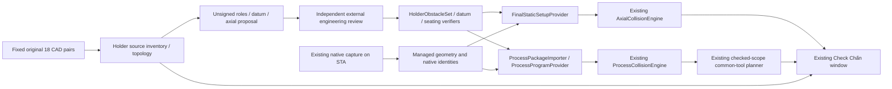

# Implemented architecture — final evidence delivery

Implementation branch: `feature/check-chan-final-evidence-delivery`, based on packet commit `53d963a11eb4b7c5a8c406ca4be8211248ed5f88` and PR #35 (`02cbe20`). This is a software delivery with explicit acceptance blockers, **not a manufacturing certificate**. See `VALIDATION_IMPLEMENTATION.md` for executed results.

## Decision and alternatives

| Alternative | Existing 18 company pairs | Human evidence | Code / freshness | Performance and risk |
|---|---|---|---|---|
| **A. External reviewed evidence adapter (chosen)** | Reuses exact fixed CAD selections, analytic LINE/ARC and bounded SPLINE geometry | Explicit contour/exclusion roles, independently approved datum/seating, measured finite axial segments and process states/motion | Unsigned editor → existing verifiers → separate final-static and process imports. Source/config/geometry/native identity, revision, signatures, artifacts and expiry remain bound. | No new numeric work when setup is missing. Native capture stays on STA; file verification and compilation run on managed workers. Small integration around existing solvers. |
| B. CAD reference simulation only | Uses the actual CAD selections through existing `CadReferenceSimulation` | Independent SimulationOnly approval of material, explicit pose/span/errors and motion | Existing source-bound simulation signature and live leases; no physical mounting claim | Useful for software experiments. Cannot answer production capability and cannot supply missing physical datums. Supported alongside A, never a fallback replacement for the company library. |
| C. Native process/registration capture | Could add measured machine setup and before/after workpiece capture | Actual machine/tool registration and a reviewed manufacturing process | Requires additional acquisition/registration evidence rather than inferring an unfold from the final Part | Highest native/COM and workflow risk. Not selected as an automatic inference path; final-Part geometry alone cannot establish this evidence. |

The source packet's Holder draft is adapted into compiled production classes. It now preserves unmatched/unsupported inventory, source INSERT lineage, current-source leases, cloned unsigned assignments, native-bound blank setup/process templates, and imports through the existing material/seating verifiers.

The reference `FinalEvidenceGate` is **not used as an authority**. Its mutable Boolean facts cannot establish a geometry certificate. The implementation projects actual guarded static/process certificates, review status and simulation flags from existing result objects. Query counts and native lifecycle remain independent report facts. No second Boolean-driven manufacturing gate or replacement solver was introduced.

## Data path

### Holder geometry and review

`HolderMaterialReviewDraftBuilder` consumes `ToolAssemblyProfile` and existing `HolderObstacleSet.Inventory/Topology`. Each source entity retains its key, type, layer, original closure flag, block/INSERT lineage, original analytic/NURBS data and approximation error. Connectivity is **an observation**, not a solid/hole/reference assignment.

`PrepareUnsigned` requires every key exactly once, explicit permitted roles, unique contour IDs and an allowed combination rule. It clones assignments and rejects stale source, missing/duplicate/foreign keys, signatures and physical attestations. `HolderObstacleSet.Read` remains the production material interpreter, including nesting, contact/overlap checks and every SPLINE boundary band. Its new read-only `ReviewedRoles` projection is populated only after successful existing verification.

`ToolEvidenceReviewWorkspace` exports/imports private proposals. Nullable datum, transform, length and error values are left absent; neither an identity transform nor a 4200/6000 mm tool span is synthesized. Native process templates copy **only** current FeatureId/PersistentId/frame/revision identifiers. They contain no invented states, geometry, motion, graph completeness or approval.

Optional `BendPlacementConfiguration.ReviewWorkspacePath` accepts one proposal or a version-1 document with `Proposals`. It is exclusive with the old Holder/seating evidence paths. Source/manifest and fixed mapping must match; every embedded material/mapping/seating record still passes its original verifier. The document cannot provide trusted authority credentials. Separate datum evidence continues through `MasterDatumEvidencePath` and `ToolDatumEvidence`.

### Final static pose is separate from process states

The baseline correctly kept alternative process sheet states out of the per-bend final-static worker. This implementation adds **`FinalStaticSources`** to the existing trusted provider configuration instead of forwarding intermediate process envelopes as the finished Part.

`FinalStaticSetupProvider` is a partial implementation of `ProcessProgramProvider`. It reads a source/revision/hash-pinned `FinalStaticSetupDocument`, compiles the observed native final envelopes using the existing compiler, and calls `ToolAxialSetupEvidence.Read` for each record. Its native binding includes snapshot, update stamp, configuration, actual FeatureId, frame and envelope digest. Record absence or bad evidence leaves the corresponding existing candidate UNKNOWN; the worker still retains all 18 tools and independent Punch/Holder results.

The provider caches managed inputs by native model, catalog, trusted configuration and package identity. Configuration, package, authority and approval artifacts are audited before publication and during existing provider polling. An additional **restrictive** envelope freshness lease withdraws held numeric results without changing analytic geometry, canonical source identity, tolerances or the native model. No COM object enters this path. `ReadinessDiagnostics` surfaces source/import failures in the existing candidate reason display.

`ProcessPackageImporter`, `CadReferenceSimulation`, `ProcessCollisionEngine` and `PartSequencePlanner` retain their existing responsibilities. A reviewed final-static CLEAR does not establish motion, a complete route or production approval. The existing planner prefers a proven unchanged common pair/setup across the supplied complete path; it does not invent a multi-tool changeover process.

### Existing UI

The existing form gains one **Hồ sơ dao** tab; no Designer or command registration changes. It includes a source viewer, entity selection/highlight, viewport-only fit/zoom/pan, editable role assignments, a private JSON proposal editor, unsigned exports and an evidence audit using configured authorities. `Holder`, `Punch`, `All` and `Selected` are viewport fits in unchanged drawing WCS, never mounting transforms. Source rows remain present even when a viewport clips distant drawing references. Preview tessellation is used only for pixels; it never enters collision input.

Static Punch/Holder and five-phase results remain separate. Simulation flags now survive the guarded read projection and are displayed explicitly. Missing geometry/evidence and stale results do not appear as successful blank evaluations. Existing Check Min projection and FeatureId location remain intact.

## Native lifetime boundary

The harness previously set `UserControl=false` and closed the final open document between cases. SOLIDWORKS documents that this can close a background session, invalidating later `OpenDoc6` and component references. `KeepOwnedBackgroundSession` now uses `UserControlBackground` **only on the exact owned PID**. Tests still explicitly call `ExitApp` and retain the original 10-second exit criterion. This removes a documented harness lifetime hazard; the isolated close/reopen A/B did not by itself reproduce every observed RPC failure, so it is not asserted to explain all crashes.

References: [SOLIDWORKS 2024 CloseDoc contract](https://help.solidworks.com/2024/english/api/sldworksapi/solidworks.interop.sldworks~solidworks.interop.sldworks.isldworks~closedoc.html), [UserControl contract](https://help.solidworks.com/2023/English/api/sldworksapi/SOLIDWORKS.Interop.sldworks~SOLIDWORKS.Interop.sldworks.ISldWorks~UserControl.html), [GetAddInObject identity contract](https://help.solidworks.com/2018/English/api/sldworksapi/SOLIDWORKS.Interop.sldworks~SOLIDWORKS.Interop.sldworks.ISldWorks~GetAddInObject.html).

New diagnostics record mapped in-process module path/SHA separately from the DLL reflected by an out-of-process harness. `SwAddin.GetBendCheckBinaryIdentity` is a read-only, appended diagnostic method; registration/callback commands are unchanged. Startup failures record the owned PID/exit status rather than falling back to a user's running session. Raw dumps, machine paths, native screenshots and detailed geometry remain private.

## Protected boundaries

- No Check Min mathematics, original CAD/Excel, command registration, WinForms Designer or numeric tolerance changes.
- No inferred tool tip, mounting transform, material role, working length, physical approval or intermediate sheet state.
- No new company signing key or installed trust/deployment/registry modification.
- No V-die inspection or manufacturing PASS. No source-open KIK repair.
- No claim that a functional native test or a controlled numeric fixture proves the actual 33 company-source setups.
