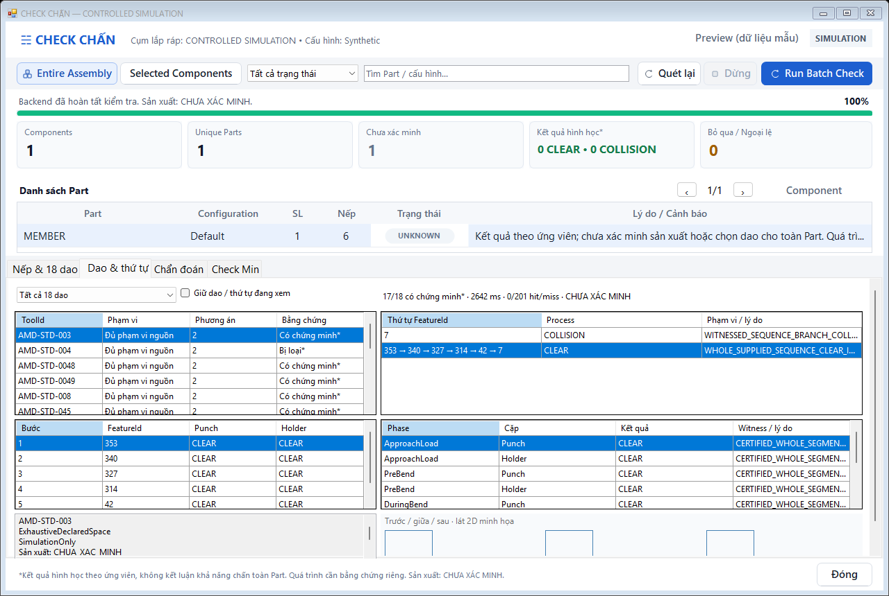
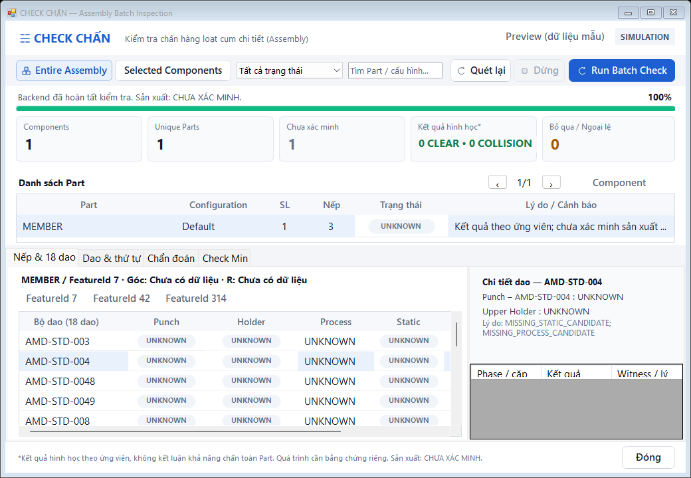

# Phase 4B unified delivery — validation and remaining acceptance gates

Date: 2026-10-19, Windows x64, SOLIDWORKS 2024 SP5 (`32.5.0.48`),
.NET Framework 4.8 / C# 7.3, Visual Studio 18 MSBuild. Baseline PR #29:
`03eb514b6a32ff7a54ff2a7787bdd2e521cb4859`.
Branch: `feature/check-chan-phase4b-unified`; Draft PR base:
`feature/check-chan-unified-ui-polish`. No PR/main merge.

## Acceptance conclusion

The common-tool/sequence solver executes real continuous numeric collision
queries on explicitly supplied process-state graphs, and the existing Check
Chấn window now exposes Part and Assembly results, bends, 18 tools, sequences,
timeline, pair/phase evidence, diagnostics and the unchanged Check Min values.
This is **not production acceptance**: actual company process/setup evidence,
native cross-bend frame registration and Assembly 120/25 stability remain
unresolved. No actual Part has been certified manufacturable or assigned a
manufacturing winner.

The native Part assertions and independent B-rep comparison pass. Windows also
records native heap-corruption crashes during shutdown of several owned test
servers. Functional assertions and server lifecycle are reported separately;
a successful assertion run is not a clean native-session PASS.

See [architecture and UX](Phase4B-UnifiedArchitecture.md) for contracts,
limits, safety conditions and the native registration/provider gap.

## Build and test matrix

Counts below describe actual runs, not planned tests. Subsets are already
included in the full managed suite; do not sum them into an inflated total.

| Check | Result | Evidence / scope |
| --- | --- | --- |
| Product Debug/x64 | PASS | Rebuild, zero errors; existing product warnings retained |
| Product Release/x64 | PASS | Rebuild, zero errors; existing product warnings retained |
| Full managed Debug | PASS | **276 tests, 8,994 assertions**, zero failures |
| Full managed Release | PASS | **276 tests, 8,994 assertions**, zero failures |
| Explicit `--assembly-tests`, Debug and Release | PASS | **20 tests / 222 assertions each**; mixed occurrence isolation, sharing and independent comparison |
| Explicit `--sequence-tests`, Debug and Release | PASS | **11 tests / 45 assertions each**; actual numeric search, cold/warm, bounded search and evidence withdrawal |
| Existing Bend Planning regression | PASS | **24 tests / 609 assertions** |
| Unified WinForms tests and rendering | PASS | **14 groups / 137 assertions**, zero failures on final render run |
| Numeric UI worker close/cancellation | PASS | Actual numeric worker; six measured cold/warm UI cases |
| Company library/process regression | PASS | **11 assertions**, all 18 source profiles retained; missing authority stays UNKNOWN |
| Native Part 0/3/6, Debug | Functional PASS | **195 assertions**; cold/warm, persistent highlight, exact Check Min projection, rebuild/Refresh and unchanged original seed |
| Native Part 0/3/6, Release | Functional PASS; overall run FAIL | **195 assertions**; final audit records `FunctionalResult=PASS`, `ShutdownResult=NOT_CONFIRMED`, harness exit 1 |
| Native six-bend geometry/library regression, Release | Functional PASS | **953 assertions**, six certified envelopes, one body capture, zero worker COM calls |
| Native six-bend independent STEP/OpenCascade | PASS | **5,232 points**, 12 interior collision witnesses, six finite clear probes, zero false/missed material |
| Native Check Min Part/Assembly + legacy UI stress | Functional PASS | **1,570 assertions** including 130 core assertions; 3 Parts / 4 occurrences, alternate configuration, selection, markers, rebuild and large rows |
| Native Assembly 120/25 Debug | FAIL | RPC during component inventory, before geometry capture/planning |
| Native Assembly 120/25 Release | FAIL | RPC opening copied fixture, before the product backend |
| Exact PR29 A/B inventory | FAIL | Same `IComponent2.Name2` RPC class on baseline, **56 assertions reached**; inventory-only, not a full batch run |
| Full native 120/25 Selected/Entire and mixed-edge suite | NOT COMPLETED | Blocked by native RPC; managed coverage is not substituted for native evidence |
| Actual Windows 125%/150% DPI | NOT RUN | Session reports `DeviceDpi=96`; scaled-control tests are not OS-DPI proof |
| Clean native session shutdown | FAIL / unresolved | Owned servers emit `0xc0000374` in `ntdll.dll` after successful assertions; new Part harness audits the exit code |

### Independent numeric oracles

| Oracle | Cases | CLEAR / COLLISION / UNKNOWN | Comparison |
| --- | ---: | --- | --- |
| GEOS 2D geometry | 552 | 346 / 201 / 5 | zero false results |
| Axial occupancy | 426 | 229 / 196 / 1 | zero false results |
| Native-family analytic geometry | 480 | 182 / 297 / 1 | zero false results |
| Continuous motion | 182 | 32 / 148 / 2 | zero errors; **103** cases defeat a sparse three-angle check |

The frozen pre-optimization process reference is byte-identical to the Phase
4A.2 reference: **1,620 pair records**, 13,932 queries, 2,268 intervals and 540
refinements. Status, reason, witness, tolerance and bounds are unchanged. The
measured export took 4,784 ms; this is not a cross-machine performance claim.

The native independent comparison exports a private STEP copy, checks exact
native bounds against OpenCascade (maximum difference about `1.8e-15 mm`),
then compares solid/void classification and collision witnesses. All six
envelopes retain certified continuous axial coverage. The 108 actual company
tool/process candidates still remain UNKNOWN: final-shape geometry does not
supply missing process laws or verified tool seating.

### What the new search tests prove

- Two supplied native-ID orders for the same Part and ToolId have different
  actual results: one has an interior DuringBend witness, another is CLEAR.
- All five phases and independent Punch/Holder results are required on each
  step. Common tools are complete paths with a constant ToolId and setup.
- One tool is rejected only inside the complete declared simulation graph;
  17 alternatives have a complete CLEAR path. No production winner is set.
- Missing phases, unsigned review, wrong source endpoints, setup changes and
  inter-bend tool teleportation cannot become common-tool proofs.
- A COLLISION without a valid matching interior witness cannot prune a path.
- Large-bend search stops lazily at node/frontier/query/memory/time limits;
  partial coverage cannot prove that a Part has no feasible sequence.
- Cancellation, supersession, source/model/setup invalidation and review
  expiry withdraw retained proofs. Warm cache restores the exact numeric
  facts to the current guards, never the previous cancellation callback.
- Assembly integration actually executes the planner for valid occurrences
  and matches independent Part results. Mirrored/modified/flexible siblings
  retain their own UNKNOWN outcome. Regression caught and fixed a second
  admission partition initially dropping the optional sequence graph.
- Bounded display reads equal strict getters; changed evidence at exit
  discards the whole view, exceptions unwind, and other threads remain strict.

## Performance

Measurements are individual runs on this workstation, not statistically
isolated A/B speed claims. Some numeric runs overlapped native diagnostics.
All synthetic fixtures are labeled simulation and add zero native captures.
An actual unverified setup that performs zero numeric queries is **not** used
as a numeric speedup result.

### Existing numeric batch engine

| Fixture | Independent per-instance ms / queries | Batch cold ms / queries | Batch warm ms / queries | Peak workers |
| --- | --- | --- | --- | ---: |
| 18 tools × 3 bends | 1,090 / 4,842 | 2,820 / 4,842 | 12 / 0 | 1 |
| 18 tools × 6 bends | 5,421 / 9,684 | 5,564 / 9,684 | 25 / 0 | 1 |
| 120 occurrences / 25 sources | 47,614 / 141,840 | 3,581 / 29,550 | 194 / 0 | 4 |

Cold geometry/static/process misses are respectively 1/1/1, 1/1/1 and
25/25/25. Warm static/process hits are 1/1, 1/1 and 25/25. The 120/25 warm
geometry cache has **0 hits / 25 misses** because its bounded working set
does not fit; the expensive static/process results are still reused.
Weighted cache bytes: 2,370,544; 4,724,320; 17,812,848. Maximum sampled managed
heap on the 120/25 run: 76,650,048 bytes cold, 62,060,352 warm. These GC
samples are not an exact peak CLR heap or total native SOLIDWORKS memory.
No measured numeric fixture exceeded the inherited 120-second process limit.
The 18×3 cold run is slower than its independent reference; it is not reported
as a solver improvement.

### New sequence planner

| Supplied graph | Cold / warm ms | Cold / warm numeric queries | Warm hits / cold misses | Nodes | Weighted cache bytes |
| --- | --- | --- | --- | ---: | ---: |
| 18 tools × 3 bends, two orders | 941 / 276 | 3,251 / 0 | 102 / 102 | 117 | 7,463,628 |
| 18 tools × 6 bends, two orders | 6,618 / 2,765 | 6,419 / 0 | 201 / 201 | 216 | 14,707,656 |

Both fixture graphs deliberately mark the declared alternatives incomplete,
so coverage remains MissingEvidence even when 17 complete paths are clear
inside the supplied space. No factorial permutation array is generated.
The benchmark uses a 120-second ceiling, but finishes below the product's
default **30-second** planner budget without changing any geometric tolerance.

### UI and native capture

Controlled numeric UI Run-to-visible cold/warm:

| Fixture | Worker cold ms | Run-to-visible cold / warm ms | Cold numeric queries |
| --- | ---: | --- | ---: |
| 18×3 | 1,306 | 1,482 / 109 | 4,842 |
| 18×6 | 2,401 | 2,511 / 133 | 9,684 |
| 120/25 | 1,767 | 1,909 / 260 | 29,550 |

The planner-detail rendering experiment fell from 1,285 ms before the bounded
display read to 235 ms in its first measured run and **280 ms** on the final
render run. Final planner time for that 18×6 display was 2,642 ms / 6,419
queries. This measures display audit overhead; it is not a change in collision
math or native capture speed.

Actual Release Part Run-to-visible / STA capture on the final shutdown-audited
run (functional assertions pass, overall lifecycle does not):

| Native Part | Cold visible ms | Cold STA capture ms | Warm visible ms |
| --- | ---: | ---: | ---: |
| 0 bends | 2,784 | 1,539 | 703 |
| 3 bends | 19,328 | 16,372 | 615 |
| 6 bends | 32,314 | 27,633 | 863 |

Debug visible cold/warm: 4,095/917, 16,751/696 and 37,117/885 ms. Warm native
Part runs assert zero new captures and one capture hit. Native company
process queries are zero because authority/process data is missing, not
because motion checking has become free. Cold STA geometry remains the main
live latency. Cancellation cannot preempt one synchronous COM/kernel call;
bounded per-capture pumping helps between captures, not inside a native call.
No COM was moved to a background worker to mask this limitation.

## Native stability investigation

1. **120/25 Debug:** diagnostic run reaches 56 assertions and 22 component
   visits, then `0x800706BE` at `IComponent2.get_Name2` in inventory. An
   earlier run returns `0x800706BA`. No planner or numeric job has started.
2. **Baseline A/B:** exact PR29 DLL on the same copied fixture also fails
   with `0x800706BE` at `IComponent2.get_Name2`. This locates a pre-existing
   native failure boundary; it does not identify the underlying native
   memory fault or establish that all inventory logic is safe.
3. **120/25 Release:** copied fixture fails in `ISldWorks.OpenDoc6` after
   three assertions, before the product batch backend is invoked. Attempts
   to build a fresh editable seed also encounter native failure in
   `IModelDoc2.AddDimension2`; these failed diagnostics are not replacement
   Assembly acceptance tests.
4. **Part rebuild/Refresh:** actually completes in both new Debug and
   Release 0/3/6-bend UI runs, with identity/currentness and unchanged Min
   checks. This demonstrates the tested route, not a universal RPC fix.
5. **KeyNotFound 24/25:** not reached in this run because inventory/open
   fails first. Still unresolved. Full original exception stacks and capped
   private phase breadcrumbs are now retained instead of losing the source
   stack through reflection or recording only an exception type.
6. **Legacy UI:** bounded message pumping and existing native stress complete
   1,570 assertions. The previous hang was not reproduced; one inherited
   1000-pixel layout warning remains (wrapped material needs 57 px; row 53).
   No timeout was increased or assertion removed in this delivery.
7. **Shutdown:** Windows Application Error events correlate the owned
   Release Part server PID with `0xc0000374` in `ntdll.dll` after assertions.
   Similar events follow other owned native runs. Cause remains unproven.
   The new Part harness waits on its original owned Process handle, records
   `FunctionalResult` separately, and fails the overall run for nonzero or
   unconfirmed exit. The final rerun reaches all 195 functional assertions,
   but the owned server has not exited within the 10-second audit window:
   `ShutdownExitCode=null`, `ShutdownResult=NOT_CONFIRMED`, harness exit **1**.
   A subsequent Windows event for that exact owned PID records the same
   `0xc0000374` native heap-corruption signature. The six-bend library run
   also has a post-assertion native shutdown event, so its 953 assertions are
   explicitly functional evidence, not a clean server-lifecycle PASS.
   It does not kill an arbitrary session or hide a crash.

Native root-cause acceptance still needs a native crash dump/debugger stack
and a stable reproducible 120/25 fixture/server environment. No speculative
product tolerance, boundary, timeout, API-order or Check Min change was made
to force these tests through.

## Status of all 18 actual company tools

All 18 DXF sources were read. Seventeen punch regions are valid closed
regions; the KIK source remains open. Four holder mappings lack sufficient
source evidence. Fourteen holder references are identified, but **none** has
verified physical seating, complete actual process states or reviewed native
sequence registration. Therefore all actual whole-Part decisions remain
UNKNOWN / `CHUA_XAC_MINH`, with no winner and no inferred clamp verification.

| ToolId | Punch region | Holder mapping reference | Physical/process/sequence proof |
| --- | --- | --- | --- |
| AMD-STD-003 | Valid | Identified | Missing — UNKNOWN |
| AMD-STD-004 | Valid | Missing evidence | Missing — UNKNOWN |
| AMD-STD-0048 | Valid | Identified | Missing — UNKNOWN |
| AMD-STD-0049 | Valid | Identified | Missing — UNKNOWN |
| AMD-STD-008 | Valid | Missing evidence | Missing — UNKNOWN |
| AMD-STD-045 | Valid | Identified | Missing — UNKNOWN |
| AMD-STD-047 | Valid | Identified | Missing — UNKNOWN |
| AMD-STD-103 | Valid | Identified | Missing — UNKNOWN |
| AMD-STD-109 | Valid | Identified | Missing — UNKNOWN |
| AMD-STD-117 | Valid | Missing evidence | Missing — UNKNOWN |
| AMD-STD-200 | Valid | Identified | Missing — UNKNOWN |
| AMD-STD-202 | Valid | Identified | Missing — UNKNOWN |
| AMD-STD-210 | Valid | Identified | Missing — UNKNOWN |
| AMD-STD-452 | Valid | Missing evidence | Missing — UNKNOWN |
| AMD-STD-453 | Valid | Identified | Missing — UNKNOWN |
| AMD-202662 | Valid | Identified | Missing — UNKNOWN |
| AMD-204662 | Valid | Identified | Missing — UNKNOWN |
| KIK-7181328001 | Open; not repaired | Identified | Missing — UNKNOWN |

Required production data: reviewed source-bound tip/mount datum and finite
Punch/Holder extents, physical pair seating, machine/setup conditions,
explicit whole-sheet process-state geometry and kinematics, cross-bend frame
registration, reviewed alternatives/completeness and a native provider/importer
for this data. The optional `AssemblyProgramData.Sequence` provider hook is
implemented; a production graph importer is not. No 4.2 m / 6 m Excel note is
promoted to verified machine capacity.

## Windows UX evidence

Only generic controlled synthetic screenshots are committed. Native company
CAD screenshots, raw exceptions, STEP, JSON coordinates, Excel, DXF and SLDPRT
remain in the private local validation directory.

Nine layout renders cover 1024×680, 1264×821 and 1920×1080 requests at control
scale factors 1, 1.25 and 1.5. DeviceDpi is 96, and Windows clamps some scaled
heights to the available monitor; this is not a true 125%/150% monitor-DPI run.
The 2,000-Part fixture renders 250 rows at a time, searches the entire dataset
and lazily renders only the selected bend/tool/sequence. Missing, cancelled,
superseded, stale and preview states have explicit messages; highlighting is
blocked when native identity/currentness cannot be proved.

## Reproduction and source protection

- Build `ADDIN.csproj` and the test projects in Debug/Release, x64. Disable
  `KillSolidWorksOnBuild`, pre/post build events and COM registration when
  running isolated validation. This delivery did not overwrite the user's
  loaded add-in DLL or terminate an unrelated SOLIDWORKS session.
- Run `ToolProfiles.Tests.exe`, `--assembly-tests`, `--sequence-tests`,
  `--sequence-benchmark <private-output>` and the existing oracle/reference
  exporters/comparison scripts.
- Run `BendAssemblyUi.Tests.exe --render <output>` and `--benchmark-ui
  <output>`. These are controlled fixtures, not native CAD evidence.
- Run `NativeAssemblyBatch.Validation.exe --part-ui <dll> <new-output>
  <part-template> <six-bend-seed> <min-workbook>` with the real tool/source
  configuration. Only private Part copies are edited/rebuilt.
- Run `NativeToolLibrary.Validation.exe <dll> <new-output> <six-bend-seed>
  <tool-directory> <min-workbook> <placement-config> --native-family-reference`
  with the explicit independent Python/OpenCascade environment.
- Optional private diagnostics: `ADDIN_BEND_CAPTURE_DIAGNOSTIC_DIRECTORY`.
  Files are capped locally and not committed.

Successful native harnesses assert original seed bytes, dirty state, active
configuration and source stamp as appropriate. Failed early Assembly runs are
not represented as completed no-change assertions. Check Min numerical files,
the Antigravity Designer and CAD/Excel sources have no changes in this PR.

### Changed files

Backend / native adapter:

- `Commands/BendPlanning/SequenceEvidence.cs`
- `Commands/BendPlanning/SequencePlanningModels.cs`
- `Commands/BendPlanning/PartSequencePlanner.cs`
- `Commands/BendAssembly/AssemblyBendMetadata.cs`
- `Commands/BendAssembly/AssemblyBatchModels.cs`
- `Commands/BendAssembly/AssemblyBatchCoordinator.cs`
- `Commands/BendAssembly/AssemblyBatchReadSnapshot.cs`
- `Commands/BendAssembly/AssemblyCacheKeys.cs`
- `Commands/BendCheckSession.PartBatch.cs`
- `Commands/BendCheckSession.AssemblyBatch.cs`
- `Commands/BendCheckSession.AssemblyInventory.cs`
- `Commands/BendCheckSession.cs`
- `Commands/BendNativeCaptureDiagnostics.cs`
- `Commands/BendEnvelope/SheetEnvelopeModels.cs`
- `Commands/BendPlacement/BendSheetSection.cs`
- `Commands/BendPlacement/BendPlacementNativeCapture.cs`

UI integration (existing Designer retained):

- `UI/BendSequencePlanningControl.cs`
- `UI/BendAssemblyBatchForm.cs`
- `UI/BendAssemblyBatchController.cs`
- `UI/BendAssemblyBatchLiveBackend.cs`
- `UI/BendAssemblyBatchModels.cs`
- `UI/BendAssemblyBatchTimings.cs`
- `UI/BendMinimumTaskPaneIntegration.cs`
- `UI/BendCheckForm.cs`

Regression and project includes:

- `Tests/BendToolProfiles/SequencePlannerTests.cs`
- `Tests/BendToolProfiles/ToolProfileTests.cs`
- `Tests/BendToolProfiles/BendAssemblyUiTests.cs`
- `Tests/BendToolProfiles/NativeUnifiedPartValidation.cs`
- `Tests/BendToolProfiles/NativeAssemblyBatchValidation.cs`
- `Tests/BendToolProfiles/NativeAssemblyBatchUiValidation.cs`
- `Tests/BendToolProfiles/NativeTestProcess.cs`
- `Tests/BendToolProfiles/ToolProfiles.Tests.csproj`
- `Tests/BendToolProfiles/BendAssemblyUi.Tests.csproj`
- `Tests/BendToolProfiles/NativeAssemblyBatch.Validation.csproj`
- `ADDIN.csproj`

Documentation / controlled screenshots:

- `Docs/BendCheck/Phase4B-UnifiedArchitecture.md`
- `Docs/BendCheck/Validation-Phase4B.md`
- `Docs/BendCheck/Images/Phase4B-Sequence-Simulation.png`
- `Docs/BendCheck/Images/Phase4B-1024-Simulation.png`
