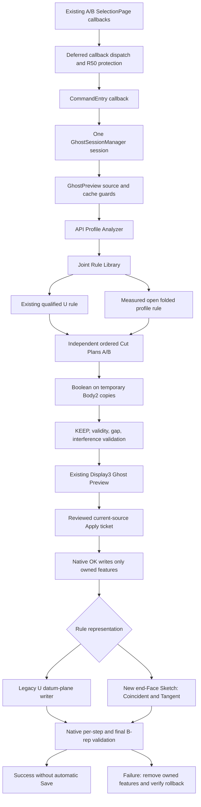

# Existing Preview and Apply flow

No A/B selection callbacks or SelectionPage source were changed in this patch. Native work stays on the existing owner-thread path. Failed rules can be reused for at most 30 seconds only when the full qualified source signature still matches; native errors are not cached as rule refusals.

For the new rule, actual B-rep support can be a perpendicular planar Face or a certified native Vertex/Edge boundary. The direction still comes from the measured Frame axes. This support witness does not establish an associative reference to the other Part.

The new face writer applies to the folded BUTT rule. The existing U representation remains a separate, explicitly documented limitation. Cross-Frame relation and end-condition probes are research only; they are not a second production Preview pipeline.
