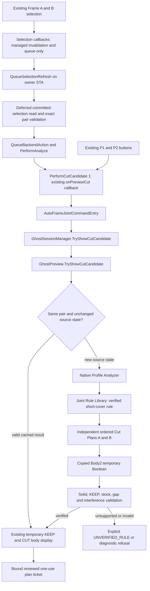
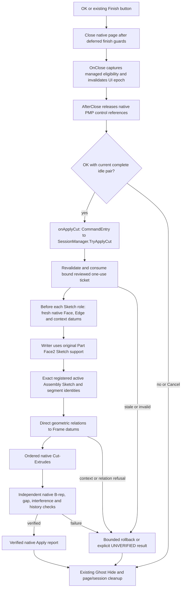

# Existing Preview and native Cut integration

These diagrams describe the existing classes and callbacks in the delivered source. They do not establish installed Add-in interaction or responsiveness; see TEST_MATRIX and KNOWN_LIMITS. There is one existing command and one Ghost Preview pipeline.

## Selection and Preview

`OnSubmitSelection` checks the supplied dispatch/type and cached managed references. Selection callbacks do not query SelectionMgr, Part geometry or component names, and do not mutate native controls during selection. Committed selection reads, focus changes and backend work run through the existing deferred owner-STA queue with epoch, revision, close and busy guards.

R55 requests KEEP through the existing `onPreviewCut` callback after deferred Analyze succeeds. P1/P2 still use that same callback and existing entry points. The older explicit-button comment in CommandEntry does not describe the additional deferred Analyze caller. No second command or Preview subsystem is created.

Deferral avoids backend work inside a native selection callback. It does not move COM work to a background thread or make a new-pair Solve nonblocking. Warm cache reuse and the measured cold Solve/Apply times remain separate evidence.

## OK, native Cut and cleanup

The native writer runs after the page is closed, through the existing apply callback. It uses existing Face2 support and geometric relations; there is no new reference-plane fallback, Convert/FIX substitution or second apply command. Preview operates on temporary Body2 copies; native Apply uses its reviewed ticket and ordered operations. The source does not automatically save the Part documents.

## Active Sketch evidence versus historical labels

`AfjUParametricSketchWriter.Reacquire` obtains relation entities from the exact registered pending `_model.SketchManager.ActiveSketch`. It verifies the bound Assembly/Part/component edit context, original Feature ID, segment IDs, construction flags, frozen transform and unchanged endpoints. `Feature.GetSpecificFeature2` is retained as an identity/transform witness; its closed Part-context aliases are not substituted as active relation handles.

The runtime evidence is the `[AFJ-U-SKETCH-CONTEXT] source=EXACT_PENDING_ACTIVE_ASSEMBLY_SKETCH` marker and its bound identity/transform checks. Some cap evidence and aggregate `ReacquisitionSource` fields retain the historical `ORIGINAL_ASSEMBLY_CONTEXT_SKETCH_FEATURE_GETSPECIFICFEATURE2` label. That compatibility label does not establish the runtime handle source. Use the actual Reacquire code, context marker and independent native constraint checks when interpreting the report.

The role-scoped datum cache also refreshes before Cover, Loser and each Cap role, after the preceding Sketch has closed. `[AFJ-U-DATUM-ROLE]` identifies that boundary. This source change preserves cutter/rule mathematics and does not relax relation or ownership checks; a cache-lifetime source review alone is not a native Cut PASS.

The query-only comparison in RELATION_CONTEXT_DIAGNOSTIC demonstrates why matching Feature/segment numeric IDs alone is insufficient: a closed Part profile alias can advertise no relation while the active Assembly profile on the same mapped support edge advertises PERPENDICULAR. That diagnostic creates no relation or Cut; the native corner tests provide the separate execution evidence.
