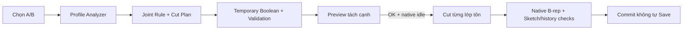

# Thay đổi R62

- Nhận diện có giới hạn các Profile hệ thống dưới `FoldUpDownSketchFolder` thuộc Flat Pattern bị suppress. Chỉ ghi nhận invalidation ngay sau đúng native Cut đã đăng ký; không cấp quyền xóa bất kỳ Feature gốc nào.
- Folder có token observation không roundtrip chỉ được xử lý cho đúng trường hợp API đã đo; không coi token đó là bằng chứng identity. Persistent identity của Flat Pattern được kiểm tra đầy đủ thay vì chỉ so wrapper COM.
- Tái sử dụng invariant đã xác minh sau Cut khi không có mutation/callback chen giữa; vẫn kiểm accepted update stamps và mọi post-mutation/final invariant.
- Log thành công chi tiết và các getter chỉ phục vụ in log chuyển sang opt-in. Lỗi và ranh giới tạo Feature vẫn ghi.
- Cả xem A/B và Preview Cut dùng chung hiển thị tách cạnh. Solver/Cut Plan và hình học Part không lấy từ bounding box hiển thị.
- Camera thay đổi chỉ dựng lại phần hiển thị từ solver cache; không giải lại cùng nguồn. Bản gốc, KEEP và CUT phân biệt bằng vị trí/màu.

FixedFace của Flat Pattern có thể đổi encoding sau native Cut dù tham chiếu logic vẫn đúng. R62 chỉ chấp nhận khi token Face gốc còn giải được đúng Face hiện tại, cùng mặt phẳng/hướng, thuộc duy nhất solid tôn hiện tại; mọi trường khác, excluded faces và ba parent vẫn giữ nguyên. Mỗi encoding mới phải được chứng minh tại đúng registered Cut, rồi cache certificate đã xác minh. Không dùng tên, bounding box hoặc chỉ mặt phẳng để đoán identity. [Chứng cứ API](API_EVIDENCE_SUMMARY.json).
