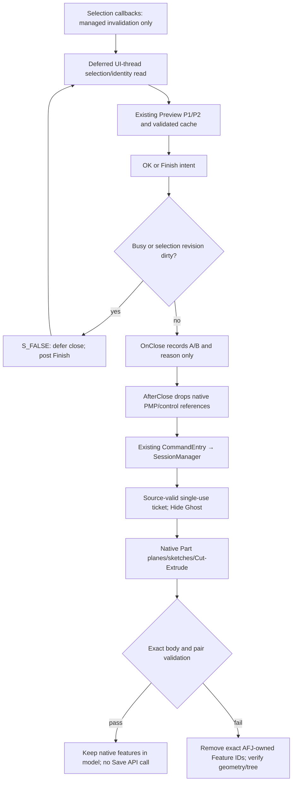

# Callback flow and scope

`OnSubmitSelection` and `OnSelectionboxListChanged` increment a managed revision. They do not read COM selection, Part models or native controls. A stable deferred identity read commits that revision. Dirty native OK is deferred with documented `S_FALSE`. The deferred Finish path reads the current A/B pair before requesting close. A changed pair cannot reuse a ticket for the previous pair.

`OnClose` performs no model mutation. `AfterClose` invokes apply before Ghost/session cleanup, only for native OK reason. Cancel, Esc and other close reasons never apply. Exceptions still enter cleanup. No Preview, stale geometry/configuration/placement, incomplete selection, ambiguous rule, shared Part or failed Hide causes a Cut to be guessed.

Native writer supports the existing subtractive prism mappings `ORTHOGONAL_U_COVER` and `ORTHOGONAL_U_TALLER_COVER`. The final 2354 case qualifies the latter. Earlier T1 native qualification is preserved separately; the final T1 setup fault does not become PASS. Other plans, addition/intersection, multi-body results, multiple independent Part configurations, nested/hidden/suppressed selected Frames, read-only documents, in-context edits and ambiguous shared reference scope are refused.

All apply work stays on the original SOLIDWORKS STA. This source has not been exercised through native PMP OK inside the installed Add-in. Native harness execution of GhostPreview/SessionManager and managed callback controls are separate evidence.

Primary API reference: [PMP OnClose / AfterClose contract](https://help.solidworks.com/2016/english/api/swpublishedapi/SOLIDWORKS.Interop.swpublished~SOLIDWORKS.Interop.swpublished.IPropertyManagerPage2Handler9~OnClose.html).
