# R56 implementation

The main changed source is the existing `AutoFrameJointGhostPreview.cs`; its internal helpers remain in that compiled class file. No project/output-path change is required.

```mermaid
flowchart LR
  A[Existing Frame A/B selection] --> B[Profile Analyzer]
  B --> C[Joint Rule Library]
  C --> D[Independent Cut Plans A/B]
  D --> E[Temporary Body Boolean]
  E --> F[Material, validity, gap validation]
  F --> G[Existing Ghost Preview]
  G --> H[Reviewed Apply ticket]
  H --> I[Existing-face constrained Sketch writer]
  I --> J[Owned native Cut transaction]
```

`AfjProfileAnalyzer` reads the original formed base flange, original SheetMetal parent, physical Sketch graph and actual t/R/axis. `AfjParametricRules` selects paired coplanar native Web skins and derives the bounded orthogonal U miter; added folds remain part of the same U section. The new general-fold branch accepts qualified near/inward/reflex suffixes after complete physical skin/Bend auditing, rather than dispatching by a filename or a guessed bounding box.

`AfjTemporaryBoolean` operates on disposable Body copies. The general branch checks exact planar KEEP separation, independent formed-stock coverage and planned removed material against measured stock. A scalar mass-property residual cannot relax geometric tolerances: when necessary, exact set containment/disjointness/coverage checks establish material partition.

`AfjUParametricSketchWriter` uses existing native Part Face2 supports and exact active Assembly Sketch handles. Every role reacquires its native entity context after the preceding Sketch closes. Direct Coincident/Parallel/Perpendicular/SameLength relationships link native Frame datums and master/loser Sketches. No Convert, FIX or new Plane is substituted. Four Sketch roles use two shared manufacturing dimensions in total: closure margin and assembly fit gap.

`AfjNativeUTransaction` and `AfjUOwnedFeatureJournal` preserve original feature identities, order, configuration, component poses and material. Suppressed passive components remain suppressed; no resolve or reference rewrite is authorized. A narrowly proved historical missing-path alias may normalize only to the exact pre-existing loaded copied Part identity with matching configuration/hash. The journal remains fresh across native mutations.

Performance changes reuse immutable passive observations only within one synchronous inventory read and reuse its already validated SheetMetal metadata handles for immediate token capture. Nothing persists across a Cut/checkpoint as a geometry shortcut. Detailed R56 counters are opt-in with `AFJ_R56_PROFILE_DETAIL=1`; legacy boundary logs remain. This reduces diagnostic overhead without claiming installed UI timing results.

Preserved entry points: `AutoFrameJointCommandEntry.Open`, `AutoFrameJointGhostSessionManager.TryShowCutCandidate`, `AutoFrameJointGhostPreview.TryShowCutCandidate`, and existing UI `onPreviewCut`. R50 control protection, cleanup and other commands are retained. Local Wall-cell prototype helpers are not included in the delivered source15 solver.
