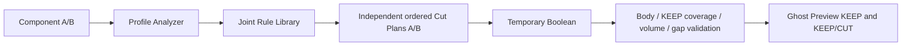

# Auto Frame Joint — parameterized U-section cut solver

**Review status: partial implementation with real geometry tests. General AFJ is not complete.** The solver generates tools from measured section topology, sheet thickness/Bend R, assembly placement and the user's cover policy. Native Cut shapes are research oracles, not runtime templates.

**Stability limit:** one SOLIDWORKS crash occurred during harness transition after the native suite. It is logged in [API diagnostics](06_API_DIAGNOSTICS.md); root cause and installed Add-in stability remain unverified.

## Confirmed policy

- The **shorter actual Frame covers**. Actual span is measured along its profile axis with exact B-rep extrema. Equal lengths require a drawing choice and are refused.
- Assembly fit gap is fixed **0.1 mm**. The separate single-sheet Cut-Extrude convention is **t + 0.1 mm**.
- Historical T1/T2 cover choices are preserved as evidence; they do not override the new user policy. KCC is cited only within its panel scope.

## Evidence and scope

- PR39 baseline: **15 native Parts / 43 API verified Cuts**; all have scalar/Sketch records, **0 strict API-complete direction-reference sets**.
- New study: **42/42 Cut before/after differences on 11 Parts**. 4114's separate Cut was not included in rollback replay.
- **28 native Cut tool replays** reproduce after B-reps (18 direct, 10 with NormalCut Bend relief); 14 curved hole/slot profiles were excluded from corner-rule generation.
- **1 parameterized rule family**, orthogonal formed U with optional outward far Return: **8/8 native corner matches**, **8 before-Cut runtime passes**, **8 public Ghost API preview passes**, **12/12 independent dimension variants**. Detailed pass/refusal records are in [TEST_RESULTS.json](TEST_RESULTS.json).
- Inclined/multi-step 1618 cases and the old height-mismatch Debug pair remain **UNVERIFIED_RULE**. The second old Debug pair is **NOT_IDENTIFIED**.

## Review files

- [Implementation and preserved entry points](01_IMPLEMENTATION_AND_SCOPE.md)
- [Native before/after method](02_BEFORE_AFTER_METHOD.md), [CSV](FEATURE_CUT_BEFORE_AFTER.csv), [JSON](FEATURE_CUT_BEFORE_AFTER.json)
- [Parameterized KEEP/CUT derivation](03_KEEP_CUT_RULES.md), [machine-readable rule](JOINT_RULES.json)
- [NormalCut and Bend](04_NORMALCUT_AND_BEND.md)
- [Test results and limitations](05_TEST_RESULTS_AND_LIMITATIONS.md), [CSV matrix](TEST_MATRIX.csv), [runtime JSON](TEST_RESULTS.json), [native oracles](NATIVE_RULE_ORACLE.json)
- [API diagnostics](06_API_DIAGNOSTICS.md), [protection](07_PROVENANCE_AND_PROTECTION.md)
- [Manual integration/build](08_MANUAL_COPY_AND_BUILD.md), [depth and assembly gap conventions](09_SHEET_THICKNESS_OVERRUN.md)

Source base: R49 `423300132a4011a1e534b5c98adf94ceeef02269`. Four existing classes carry this patch; all internal helpers are in GhostPreview.cs so no .csproj change is required. The user's working checkout and original CAD were not edited. Main Add-in was **not built/rebuilt/registered/deployed**. Only detached STA harnesses were compiled. Installed PMP selection/button behaviour and visual QA remain UNVERIFIED; Display3/Hide API results are recorded separately.
