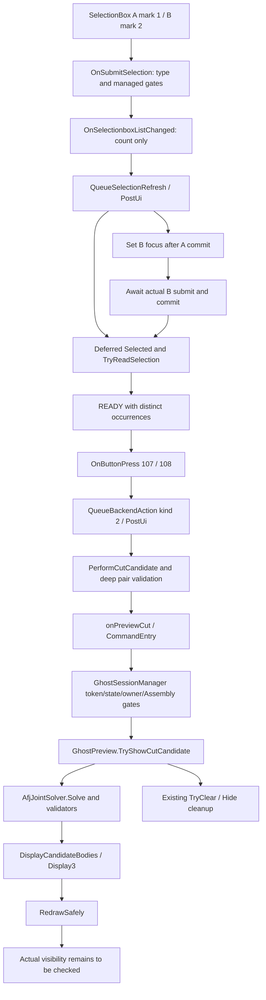

# Luồng Preview duy nhất

## Callback và selection

`BuildControls` vẫn tạo cùng ID 101/102, marks 1/2, SingleEntityOnly và filter Faces/Edges/Components. Không thêm `COMPSDONTOVERRIDE`, không remap A/B, không đổi callbacks công khai. Native controls `Enabled` vẫn không được ghi theo bảo vệ R50.

`OnSubmitSelection` chỉ đọc tham số và trạng thái managed, QueryInterface thông qua cast dispatch đã nhận; không gọi SelectionMgr, active-document COM, `GetComponent`, `IsSame` hoặc `Name2` tại đây. Duplicate có cùng cached RCW reference có thể bị từ chối sớm; identity COM chắc chắn được xác minh sau commit. Nếu native chưa cung cấp itemText, dùng nhãn Frame A/B; tên occurrence thực chỉ đọc/log sau callback. Không giữ/lưu dispatch selection tạm từ submit.

`OnSelectionboxFocusChanged` ghi cache ID focus; `OnSelectionboxListChanged` ghi count do callback cung cấp và post việc. Chúng không resolve body, đọc selection COM hay sửa native control inline. Callback-depth guard chặn việc đọc nếu message bị re-enter trong callback.

Tại lượt UI được post, `Selected(mark)` yêu cầu đúng một selection theo mark, thử `GetSelectedObjectsComponent4`, tiếp đến `GetSelectedObject6`, rồi owner `IEntity.GetComponent`. Ready kiểm tra Assembly đang active và hai occurrence khác nhau qua `IsSame`. Deep check trước action yêu cầu cả hai document là Part đã tải. Không Resolve/Unsuppress tự động.

Sau A commit, focus có thể chuyển B. Log mới kiểm tra lại `B.GetSelectionFocus()` sau lời gọi, nhưng không tự chèn selection B. Chỉ khi B submit và list commit thật thì `B-count=1` mới có ý nghĩa. Tự phân tích sau B tiếp tục là read-only Analyze; **không tự Preview**.

## Action và backend

Nút 107/108 đi qua `QueueCutCandidate` → `QueueBackendAction(kind=2)` → WinForms `BeginInvoke` trên UI owner. `PerformCutCandidate` xác minh lại selection trước `onPreviewCut`. Không Boolean/Display3 trong `OnButtonPress`.

Entry chỉ gọi manager hiện có. Manager giữ token, UI thread, session state và Assembly identity; không tạo Ghost/command thứ hai. Ghost dọn preview cũ, xác minh Component top-level, hidden/suppressed và Assembly, rồi gọi solver R51. R52 không đổi rule/Boolean/validation helpers. Kết quả được chuyển tới Display3 và cleanup hiện có.

`OnClose` invalidates epoch trước khi native controls được thả; posted action cũ bị bỏ. `AfterClose` gọi cleanup và session vẫn giữ body chưa Hide được. BuildControls, `IsUiLive`, `SetCaption`, readiness identity và core R51 đều có kiểm tra bất biến source; xem evidence.
