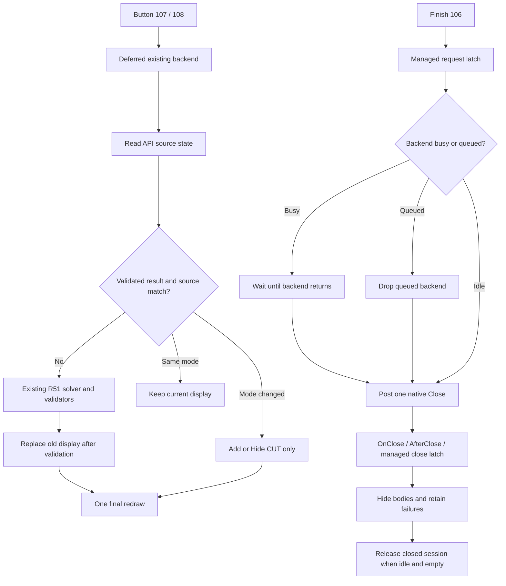

# R52 — Preview mượt hơn và xử lý Kết thúc

Ngày: 2026-10-22. Tiếp nối sửa Caption trong cùng Draft PR #43. Đây là cập nhật source, chưa chạy bản sửa mới trong DLL Add-in.

## 1. Log mới thực sự chứng minh gì

- Người dùng xác nhận đã nhìn thấy Preview; trạng thái `USER_CONFIRMED_VISIBLE`.
- DLL có MVID `023f24dd-0f95-4cdd-9352-2629defdfab7`, khớp log. **267/267 method AFJ khớp IL chuẩn hóa của harness Caption cũ**. DLL/PDB khớp GUID/age. Parser không cung cấp checksum source trong PDB.
- Có 3 lần mở trang, 4 lần bấm 107, 0 lần 108, **0 lần 106**. Bốn lần solver hoàn tất đều giữ 1 Body A + 1 Body B, lượng bỏ A khoảng 71.753,398 mm³ và B khoảng 68.665,694 mm³. Cả 8 Display3 trả status=0. Không biến status API thành bằng chứng pixel; xác nhận nhìn thấy đến từ người dùng.
- Có 3 `CLOSE reason=1` / `AFTER_CLOSE`, 8 `HIDE_END`; log cuối ghi dọn xong rồi process thoát `0xffffffff`. **Chưa xác minh nguyên nhân thoát**, chưa chứng minh nút 106 hoạt động trong phiên này. Không có dòng AccessViolation trong file mới; điều này không chứng minh mọi lỗi bộ nhớ đã hết.
- File cũ không có thời gian từng phase. Chưa có số đo latency hoặc tuyên bố nhanh hơn bao nhiêu lần. Query Application event 1000/1001 từ 12:20 không trả event khớp; không đủ để kết luận có/không crash. Hiện chỉ thấy một SOLIDWORKS ẩn, không tương tác hoặc mở thêm phiên.

Xem [log ranh giới đã lọc](evidence/smooth_finish/user_native_boundaries.log), [metrics](evidence/smooth_finish/native_log_metrics.json), [source/DLL](evidence/smooth_finish/installed_binary_verification.json).

## 2. Nguyên nhân xác minh từ source

1. `TryShowCutCandidate` trước sửa luôn Hide → redraw → Solve toàn bộ → Display → redraw, kể cả bấm lại cùng P1. Việc tính lặp và redraw trung gian là có thật; mức đóng góp vào độ chậm chưa đo native.
2. `QueueFinishPage` trước sửa gặp backend bận hoặc đã xếp hàng thì chỉ log “deferred” rồi return, không giữ yêu cầu hoặc xếp lại. Đây là lỗi có thể làm mất một lần bấm Kết thúc, **không phải nguyên nhân đã chứng minh của exit trong log mới**, vì log đó không có 106.
3. Close reentrant trong lúc chưa đăng ký Body có thể đi qua `FinishEmpty` khi backend còn chạy. Source cần giữ session tới lúc backend trả về và ngăn hiển thị tiếp sau Close.

## 3. Ba class được sửa

### `AutoFrameJointGhostPreview`

- Cache **một** kết quả Boolean đã qua toàn bộ validator của R51, trong cùng session. Trước khi reuse, đọc API: update stamp Assembly/2 Part/2 Body; cấu hình Assembly và cấu hình tham chiếu/đang active của Part; đủ 16 phần tử transform; identity Component/Part/Body bằng `IsSame`. Giữ đúng thứ tự A/B. Không dùng tên, bounding box hoặc thể tích làm khóa cache.
- API identity/stamp/config/transform không đọc được: tắt reuse, chạy solver đầy đủ; không phỏng đoán. Có thay đổi nguồn trong lúc solve: không hiển thị kết quả cũ. Cache bị xóa khi Clear, lỗi, đổi nguồn hoặc Close. Các Body đã đăng ký hiển thị vẫn có owner riêng đến khi Hide thành công.
- Cùng P1/P2 và nguồn khớp: trả kết quả đang hiển thị, không Solve, Copy, Hide, Display3 hoặc redraw lại.
- P1→P2: giữ nguyên KEEP, chỉ hiển thị các Body CUT. P2→P1: chỉ Hide CUT. Mỗi lần đổi chế độ redraw một lần. Chưa cam kết cache HIT trong native nếu host thay stamp/identity; fallback đầy đủ vẫn an toàn.
- Với nguồn mới, giữ hình Preview cũ đến khi solver mới qua validation, rồi thay hình với một redraw cuối. Không đổi vị trí +120 mm, màu hoặc phép đổi hệ tọa độ.
- Projection diagnostic 8 góc được opt-in bằng biến môi trường `AFJ_TRACE_VIEWPORT=1`; mặc định không chạy. Không dùng projection để quyết định cutter hay PASS hiển thị.
- Thêm timing `source_state`, `solve`, `replace_hide`, `display`, `preview_total` và HIT/MISS/INVALID/DISABLED. Timing harness chỉ chứng minh có instrumentation; không phải benchmark SOLIDWORKS.
- Close được latch bằng managed state; kiểm tra trước hiển thị thêm Body. Không cố ngắt một lời gọi kernel đang chạy và không pump message/Task.Run COM.

### `AutoFrameJointSelectionPage`

- `finishRequested` giữ yêu cầu kể cả lúc bận; backend đang xếp hàng bị hủy trước khi chạy, action đang chạy trả về rồi mới post Close. Một Close cho mỗi yêu cầu; standard Close invalidates epoch và hủy công việc cũ.
- Finish ưu tiên trước auto-analysis, selection refresh và action mới. Không đọc selection hoặc gọi native Close ngay trong callback chọn/nút.
- Exception COM thông thường khi Close cho phép người dùng bấm lại; không retry vô hạn và không cố recover AccessViolation.
- Giữ A/B marks, filters, OnSubmitSelection, OnSelectionboxFocusChanged, OnSelectionboxListChanged, OnButtonPress và IsUiLive giống trước ở mức method body. Giữ cách publish SetMessage3; không có runtime Caption/Enabled setter.
- Thêm `FINISH_REQUEST`, `FINISH_WAIT`, `FINISH_CLOSE_BEGIN/RETURN`, `AFTER_CLOSE_END` và elapsed time action/cleanup.

### `AutoFrameJointGhostSessionManager`

- Close gửi managed latch cho Ghost. Session còn backend bận được giữ ở PendingCleanup kể cả chưa có Body; không bỏ owner sớm.
- Sau backend trả về, wrapper hoàn tất cleanup của session đã Close thay vì ghi lại state Showing. Hide lỗi tiếp tục giữ references để retry có chủ ý; không bỏ tham chiếu Body đang hiển thị.

**Không đổi** R51 rule library, Cut Plan, cutter factory, Boolean kernel calls hay validators. Toàn bộ source từ `AfjOperationKind` đến cuối file Ghost giống trước. Không tạo command hoặc hệ Preview khác; CommandEntry không sửa trong follow-up này.

## 4. Sơ đồ luồng

## 5. Kiểm thử và giới hạn

**30/30 managed controls cho source local; 30/30 cho branch**. Hai lần biên dịch x64 explicit-source 6 class thành EXE harness riêng, không dùng `.csproj` hoặc output Add-in.

Có thể lặp lại bằng [RunManagedControls.ps1](evidence/smooth_finish/RunManagedControls.ps1), chỉ định compiler C# .NET Framework và thư mục ba SOLIDWORKS Interop bằng `-CompilerPath` / `-InteropDirectory`. Script biên dịch harness vào thư mục TEMP riêng; không mở SOLIDWORKS và không Build project Add-in.

Controls kiểm tra A/B, callback không đọc interface inline, P1/P2 delegates, Caption channel, stale epoch; Finish khi queued/running, double Finish, standard Close, ordinary Close failure; cache predicates; repeated P1; đổi mode; Hide failure; nonzero Display3; reentrant Close và session ownership. Không có lời gọi interface trong callback selection, không có lời gọi native Label. Body2 trong các controls là **proxy**, kết quả solver được nạp giả lập để kiểm tra đường cache/hiển thị. Không chạy kernel hình học và không biến PASS_MANAGED_CONTRACT thành API_VERIFIED.

| Trường hợp | Trạng thái |
| --- | --- |
| Preview trước follow-up nhìn thấy | USER_CONFIRMED_VISIBLE |
| R52 Caption trước follow-up chạy trong Add-in | USER_NATIVE_LOG / BINARY_VERIFIED |
| Cache/Finish follow-up trong Add-in thực | NOT_RUN |
| First solve, latency P1/P2 thực, 106/OK/Esc, reopen, ổn định process sau Close | NOT_RUN |
| Geometry replay mới 2354/1618/3615 | NOT_RUN; R51 geometry source giữ nguyên, không ghi thêm PASS |
| Nguyên nhân exit 0xffffffff | UNVERIFIED |
| OK tạo Cut thật | NOT_IMPLEMENTED; lệnh hiện chỉ Preview và đóng, không ghi Part |

[CSV matrix](SMOOTH_FINISH_MATRIX.csv), [JSON](SMOOTH_FINISH_MATRIX.json), [summary](SMOOTH_FINISH_SUMMARY.json), [invariants](evidence/smooth_finish/source_invariants.json).

## 6. Tích hợp thủ công và kiểm tra cần làm

Source local đã áp dụng đúng ba file trên, có SHA guard. Branch/HEAD người dùng, ba class AFJ khác, `.csproj`, DLL/PDB/output không đổi; xem [protected files](evidence/smooth_finish/protected_files.json). **DLL vẫn là bản Caption cũ** cho đến khi chủ dự án Build thủ công. Codex không Build/Rebuild/F5/Deploy Add-in, không save/rebuild CAD và không merge.

Manifest báo cáo dùng byte/hash chuẩn hóa CRLF→LF để đối chiếu nội dung GitHub. SHA trong source audit/protected files là byte thực của file Windows lúc áp dụng; nếu line ending hoặc baseline khác, cần review, không bỏ qua guard.

Đối với checkout khác, dùng [LOCAL_INCREMENTAL.patch](evidence/smooth_finish/LOCAL_INCREMENTAL.patch) chỉ khi đúng các before SHA trong [audit](evidence/smooth_finish/source_patch_audit.json); `git apply --unidiff-zero --check` trước khi áp dụng. Patch branch dành riêng baseline commit trước của PR43, không copy đè toàn bộ class giữa hai baseline. Nếu SHA khác, đối chiếu từng method; không force.

Sau Build thủ công của chủ dự án:

1. Xác nhận MVID mới và log PERF. Chọn 2354 fr04/fr03 qua A/B như cũ.
2. Bấm P1 lần đầu, bấm lại P1, P2 rồi P1. So elapsed `solve`/`preview_total`, HIT/MISS, số Display3/Hide; tự xác nhận KEEP vẫn đúng và CUT bật/tắt đúng. Chưa có số chuẩn latency để gọi PASS độ mượt.
3. Đổi vị trí/config/geometry theo quy trình chủ dự án; cache phải MISS, không hiển thị kết quả trước thay đổi. Không cần thay CAD để chạy managed harness.
4. Thử 106, OK và Esc; kiểm tra FINISH_CLOSE_RETURN + AFTER_CLOSE_END, không còn ghost, mở lại lệnh được và process còn sống. Thử thêm Finish lúc đang xếp hàng; thao tác kernel đang chạy vẫn cần trả về trước khi native Close an toàn.
5. Nếu exit lặp lại, giữ log có timestamp và crash/call stack của chính phiên đó. Không quy kết lỗi kernel hay UI từ riêng exit code.

Tài liệu API cho chính sách invalidation: [IModelDoc2.GetUpdateStamp](https://help.solidworks.com/2025/english/api/sldworksapi/SOLIDWORKS.Interop.sldworks~SOLIDWORKS.Interop.sldworks.IModelDoc2~GetUpdateStamp.html) mô tả stamp tăng khi model state/geometry đổi; [IBody2 members](https://help.solidworks.com/2021/english/api/sldworksapi/SolidWorks.Interop.sldworks~SolidWorks.Interop.sldworks.IBody2_members.html) mô tả GetUpdateStamp của Body từ lần rebuild cuối. Vì vậy không dùng riêng Body stamp; còn kiểm tra document, config, transform và identity. Đây là thiết kế invalidation từ tài liệu, hiệu quả native của cache mới chưa đo.
