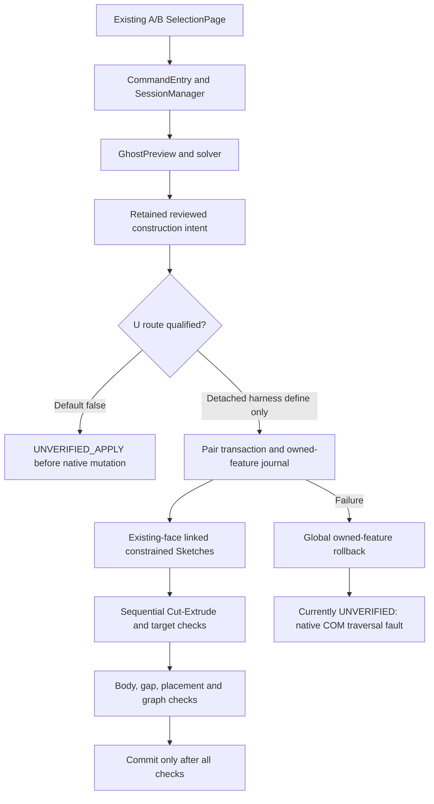

# Prepared route and qualification boundary

The candidate full entrypoint has compiled only; it has not executed in the installed Add-in. The earlier four-Cut roundtrip and latest partial transaction driver have different scope.
